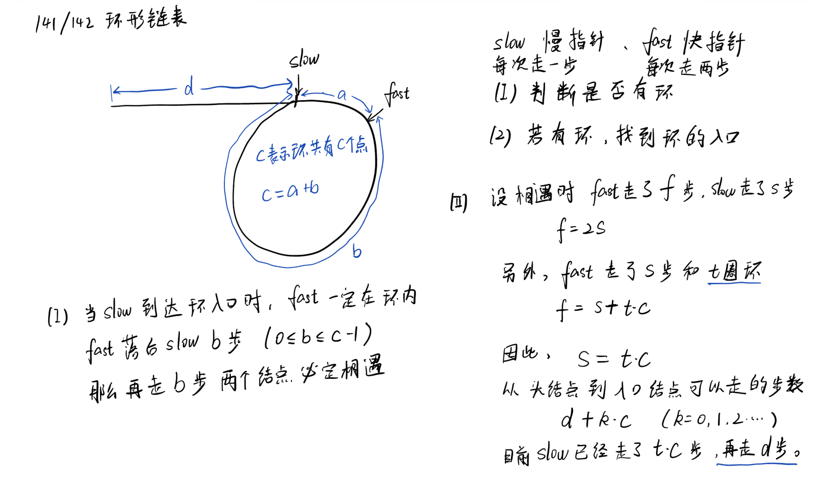

# CodeTop 第1–100题

### [LeetCode 3. 无重复字符的最长子串](https://leetcode.cn/problems/longest-substring-without-repeating-characters/)

题意

给定字符串 s，求其中不含重复字符的最长连续子串长度。

解题思路

滑动窗口＋哈希表

暴力思路：O(n ^ 3)，枚举右边界从小到大，枚举左边界从小到大，遍历判断是否有重复元素

优化，枚举右边界从小到大，枚举左边界**从大到小**，并且维护已经出现的元素，如果重复，就不用再枚举左边界了。也就是找到当前右边界的最左

优化，枚举左边界从大到小，发现了如果出现了重复，接下来的左边界不用再枚举。并且发现性质，在有边界继续右移的过程中，左边界不会左移。证明，如果左边界能够左移，那么在右边界没有右移的之前，左边界就应该可以

------

### [LeetCode 146. LRU 缓存](https://leetcode.cn/problems/lru-cache/)

题意

实现容量固定的 LRU 缓存，支持 get/put ：O(1) 返回值并维护最近最少使用淘汰策略。

解题思路

O(1) get用哈希表，O(1) add/remove用链表

双向链表存放访问顺序＋哈希表 key→节点；访问或插入时将节点挪到表头，超容量时移除表尾。

------

### [LeetCode 206. 反转链表](https://leetcode.cn/problems/reverse-linked-list/)

题意

反转单链表，返回新表头。

解题思路

迭代：三指针 prev / cur / next 逐步反转 next 指向，

递归：返回值为新头，后序修改指针。

------

### [LeetCode 215. 数组中的第K个最大元素](https://leetcode.cn/problems/kth-largest-element-in-an-array/)

题意

在未排序数组中找出第 K 大（排序后索引 n‑K）元素。

解题思路

快速选择：平均 O(n)；

最小堆维护 K 个元素 O(n log K)。

------

### [LeetCode 25. K 个一组翻转链表](https://leetcode.cn/problems/reverse-nodes-in-k-group/)

题意

将链表每 K 个节点为一组整体反转，剩余不足 K 保持原顺序。

解题思路

先预判是否有足够节点，再局部反转后与前后段连接；迭代处理下一组。

------

### [LeetCode 15. 三数之和](https://leetcode.cn/problems/3sum/)

题意

给定整数数组，找所有 a+b+c=0 且不重复的三元组。

解题思路

先排序；固定 i 后用左右双指针扫剩余区间，跳过重复值。

------

### [LeetCode 53. 最大子数组和](https://leetcode.cn/problems/maximum-subarray/)

题意

求连续子数组最大和。

解题思路

Kadane：遍历累加，若当前和<0 则重置；期间更新答案。

------

### [LeetCode 5. 最长回文子串](https://leetcode.cn/problems/longest-palindromic-substring/)

题意

返回字符串中的最长回文连续子串。

解题思路

中心扩展 O(n²) 易写；或 Manacher O(n)。

------

### [CodeTop 补充题4. 手撕快速排序](https://leetcode.cn/problems/sort-an-array/)

题意

手写原地快速排序算法。

解题思路

选基准，双指针或单指针分区，递归／尾递归排序子区间；注意随机化基准降低最坏情况。

------

### [LeetCode 21. 合并两个有序链表](https://leetcode.cn/problems/merge-two-sorted-lists/)

题意

将两个升序链表合并成新的升序链表。

解题思路

哑节点＋两指针逐步比较接入；剩余部分直接挂到尾部。

------

### [LeetCode 200. 岛屿数量](https://leetcode.cn/problems/number-of-islands/)

题意

给定 0/1 矩阵求连通块数量（四向）。

解题思路

DFS

:star:BFS：节点入队前标记，才能保证时间复杂度是O(V+E)

并查集计数。

------

### [LeetCode 102. 二叉树的层序遍历](https://leetcode.cn/problems/binary-tree-level-order-traversal/)

题意

按层从上到下、每层从左到右输出节点值。

解题思路

队列 BFS；记录当前层大小或双队列分层。

------

### [LeetCode 33. 搜索旋转排序数组](https://leetcode.cn/problems/search-in-rotated-sorted-array/)

题意

在旋转升序数组中搜索目标值，返回索引或 -1。

解题思路

改造二分：每步判断哪个区间有序并定位目标所在半区。

------

### [LeetCode 1. 两数之和](https://leetcode.cn/problems/two-sum/)

题意

在数组中找到两数之和等于目标值，返回索引。

解题思路

哈希表记录已遍历数字→索引，边扫边查补数，O(n)。

------

### [LeetCode 88. 合并两个有序数组](https://leetcode.cn/problems/merge-sorted-array/)

题意

把 nums2 合并入 nums1 （有足够尾部空间），保持升序。

解题思路

从两数组尾部向前双指针填充 nums1 末尾，避免额外空间。

------

### [LeetCode 46. 全排列](https://leetcode.cn/problems/permutations/)

题意

输出数组所有不同的全排列。

解题思路

回溯＋交换或使用 used 数组；遇到重复需剪枝。

------

### [LeetCode 20. 有效的括号](https://leetcode.cn/problems/valid-parentheses/)

题意

判定字符串括号是否成对、顺序正确。

解题思路

栈保存左括号；遇右括号匹配栈顶，失败即非法。

------

### [LeetCode 121. 买卖股票的最佳时机](https://leetcode.cn/problems/best-time-to-buy-and-sell-stock/)

题意

一次买卖获得的最大利润。

解题思路

扫描记录历史最小价 minPrice，实时更新 maxProfit=price-minPrice。

------

### [LeetCode 300. 最长递增子序列](https://leetcode.cn/problems/longest-increasing-subsequence/)

题意

返回数组中严格递增子序列的最长长度。

解题思路一

动态规划

解题思路二

贪心＋二分：维护 tails[i] 为长度 i+1 的 LIS 结尾最小值，对每个数二分更新，O(n log n)。

------

### [LeetCode 236. 二叉树的最近公共祖先](https://leetcode.cn/problems/lowest-common-ancestor-of-a-binary-tree/)

题意

在二叉树中求节点 p 与 q 的最近公共祖先（LCA）。

解题思路

递归后序：若当前节点等于 p/q 或分布在两侧，则返当前；向上传递非空子结果。

------

### [LeetCode 103. 二叉树的锯齿形层序遍历](https://leetcode.cn/problems/binary-tree-zigzag-level-order-traversal/)

题意

层序遍历时交替从左→右、右→左输出节点值。

解题思路

普通 BFS 加方向标志。:star:Collections.reverse()使用

使用双端队列按层弹入写出实现方向切换。

---

### [LeetCode 92. 反转链表 II](https://leetcode.cn/problems/reverse-linked-list-ii/)

题意

将链表第 m 到 n 个节点区间原地反转，其余保持顺序。

解题思路

哑节点定位 m‑1 处的 pre；从 m 开始逐个头插到 pre 后方，共执行 n‑m 次，一次遍历完成。

------

### [LeetCode 23. 合并 K 个升序链表](https://leetcode.cn/problems/merge-k-sorted-lists/)

题意

将 K 条升序链表合并为一条升序链表。

解题思路

最小堆存每条链表当前头节点，弹出最小并推进下一节点；总复杂度 O(N log K)。

------

### [LeetCode 54. 螺旋矩阵](https://leetcode.cn/problems/spiral-matrix/)

题意

按顺时针螺旋顺序输出矩阵所有元素。

解题思路一

维护上下左右四个边界，循环按 →↓←↑ 方向走完一层后收缩边界直至越界。

解题思路二

模拟遍历，需要记录已经遍历的标记。转向后下一个位置要重新计算。

------

### [LeetCode 143. 重排链表](https://leetcode.cn/problems/reorder-list/)

题意

将 L0→L1→…→Ln 重排为 L0→Ln→L1→Ln‑1→… 。

解题思路

找中点，反转后半链表，再头尾指针交叉合并。

------

### [LeetCode 141. 环形链表](https://leetcode.cn/problems/linked-list-cycle/)

题意

判断单链表是否存在环。

解题思路

快慢指针（Floyd）。slow 每次走 1 步，fast 走 2 步；若存在环两指针终会相遇，否则 fast 先到 null。



------

### [LeetCode 56. 合并区间](https://leetcode.cn/problems/merge-intervals/)

题意

合并所有重叠区间，返回不重叠区间集合。

解题思路

按左端点排序，遍历维护当前区间的右端最大值；若下一区间起点 ≤ 当前右端则更新右端，否则输出并重启。

------

### [LeetCode 415. 字符串相加](https://leetcode.cn/problems/add-strings/)

题意

给定两个非负数字字符串，输出它们的和（仍为字符串）。

解题思路

从尾到头按位相加，记录进位，最后若有进位再补 '1'。

------

### [LeetCode 72. 编辑距离](https://leetcode.cn/problems/edit-distance/)

题意

将单词 word1 转换为 word2 的最少操作数（插入、删除、替换）。

解题思路

DP：dp[i][j] 表示前 i,j 字符最小操作，转移取三种操作最小值 +1；空间可滚动数组。

------

### [LeetCode 160. 相交链表](https://leetcode.cn/problems/intersection-of-two-linked-lists/)

题意

找出两条单链表相交的起始节点，若不相交返回 null。

解题思路

双指针分别遍历 A→B、B→A，第二轮长度一致；首次相遇即为交点或 null。

------

### [LeetCode 1143. 最长公共子序列](https://leetcode.cn/problems/longest-common-subsequence/)

题意

求两个字符串的最长公共子序列长度。

解题思路

DP：dp[i][j] = dp[i‑1][j‑1] + 1（相等）否则 max(dp[i‑1][j], dp[i][j‑1])。

------

### [LeetCode 42. 接雨水](https://leetcode.cn/problems/trapping-rain-water/)

题意

数组表示柱高，求可接雨水体积。

解题思路

双指针维护左右最大值；较小侧决定水位并向内移动。O(n) & O(1)。

------

### [LeetCode 19. 删除链表的倒数第 N 个结点](https://leetcode.cn/problems/remove-nth-node-from-end-of-list/)

题意

一次遍历删除链表倒数第 N 个节点。

解题思路

快指针先走 N 步，随后慢指针一起走至末尾，慢指针前驱即待删节点前一位。

------

### [LeetCode 93. 复原 IP 地址](https://leetcode.cn/problems/restore-ip-addresses/)

题意

将数字字符串分割成所有合法 IPv4 地址形式。

解题思路

回溯枚举 4 段，每段长度 1‑3 且数值 ≤255 且无前导 0；深度=4 且用完全部字符即加入答案。

------

### [LeetCode 124. 二叉树中的最大路径和](https://leetcode.cn/problems/binary-tree-maximum-path-sum/)

题意

二叉树任意节点出发到任意节点（含单点）的最大路径和。

解题思路

后序遍历计算以当前节点为根的“最大向上贡献”，全局变量记录跨过当前节点左右子树的最大路径。

------

### [LeetCode 82. 删除排序链表中的重复元素 II](https://leetcode.cn/problems/remove-duplicates-from-sorted-list-ii/)

题意

已升序链表中若某值出现多次则全部删除，仅保留不重复元素。

解题思路

哑节点＋双指针；当发现重复值时跳过整段重复区间。

------

### [LeetCode 4. 寻找两个正序数组的中位数](https://leetcode.cn/problems/median-of-two-sorted-arrays/)

题意

给定两升序数组，返回整体中位数，要求 O(log (m+n))。

解题思路：二分

二分较短数组的切分位置，两个数组，只要找一个数组的切分位置，另一个数组的切分位置也确定了。

找长的二分还是短的二分？短的，因为切分短的可以确保a[l1 - 1]和b[l2]两个值存在

二分的条件是？a[l1 - 1] <= b[l2]，也就是找这个条件的右端点。

为什么只需要a[l1 - 1] <= b[l2]，另一个条件b[l2 - 1] <= a[l1]如何证明也能成立？反证法，如果不成立，那么当前l1就可以右移

------

### [LeetCode 142. 环形链表 II](https://leetcode.cn/problems/linked-list-cycle-ii/)

题意

在有环链表中返回入环节点。

解题思路

Floyd 相遇后，一指针回到头，两指针同步前进，相遇点即入口。

------

### [LeetCode 165. 比较版本号](https://leetcode.cn/problems/compare-version-numbers/)

题意

给定两个版本号 a、b（由数字和点组成），比较它们大小：返回 1 / ‑1 / 0。

解题思路

按点分割转整形数组，从前向后逐段比较；短版本视为补 0。遇首个不等立即返回，其余相同则返回 0。

------

### [LeetCode 199. 二叉树的右视图](https://leetcode.cn/problems/binary-tree-right-side-view/)

题意

从右侧观察二叉树，每层看到的最右节点值序列。

解题思路

层序 BFS 记录每层最后一个节点；或 DFS 先右后左，首次到达的深度即答案。

------

### [LeetCode 239. 滑动窗口最大值](https://leetcode.cn/problems/sliding-window-maximum/)

题意

数组 nums，每个长度 k 的滑窗内最大值序列。

解题思路

单调递减双端队列存索引；队头保持窗口最大且索引合法，队尾维护递减性。每步输出队头对应值。

------

### [LeetCode 704. 二分查找](https://leetcode.cn/problems/binary-search/)

题意

在升序数组中查找目标值，返回索引，否则 ‑1。

解题思路

经典二分模板；mid = l+(r‑l)/2，比较后收缩区间，循环结束未找到返回 ‑1。

------

### [LeetCode 22. 括号生成](https://leetcode.cn/problems/generate-parentheses/)

题意

给定 n，对所有合法的 n 对括号组合列出。

解题思路

搜索：组合的结果长度为2n固定，也就是枚举每个位置选哪个括号，:star:这题用枚举选哪个比较合适，:star:确保左括号前缀数量要比右括号多。

------

### [LeetCode 69. x 的平方根](https://leetcode.cn/problems/sqrtx/)

题意

计算 ⌊√x⌋（非负整数）。

解题思路

二分，l,r,mid溢出问题，直接开long

------

### [LeetCode 32. 最长有效括号](https://leetcode.cn/problems/longest-valid-parentheses/)

题意

求最长的连续有效括号子串长度。

解题思路一

栈：存上一个未匹配右括号索引；遇 '(' 入栈，遇 ')' 弹栈并计算长度；

解题思路二

动态规划：若是')'，分两步，先找他的配对（配对有两种情况），再加上前面一段。

------

### [LeetCode 148. 排序链表](https://leetcode.cn/problems/sort-list/)

题意

在 O(n log n) 时间和 O(1) 额外空间内对链表排序。

解题思路

自顶向下或自底向上归并排序。找中点拆分递归排序并合并；迭代版自底向上更易保证 O(1) 空间。

------

### [LeetCode 94. 二叉树的中序遍历](https://leetcode.cn/problems/binary-tree-inorder-traversal/)

题意

按左‑根‑右顺序输出二叉树节点值。

解题思路

方法一：递归

方法二：迭代用栈模拟，沿左链入栈，回溯访问右子树。

### [LeetCode 232. 用栈实现队列](https://leetcode.cn/problems/implement-queue-using-stacks/)

题意

用两个栈实现队列的 push、pop、peek、empty。

解题思路

inStack 负责入队，outStack 负责出队；当 out 为空时，将 in 全部弹入 out 实现顺序翻转，全部操作均摊 O(1)。

------

### [LeetCode 31. 下一个排列](https://leetcode.cn/problems/next-permutation/)

题意

给定排列，原地得到字典序下一排列；若无则变最小序。

解题思路

- 从后向前找到首个严格降序对 i，如不存在则整体反转；

- 再从尾找首个 > nums[i] 的元素 j，交换 i、j，

- 最后反转 i+1…end。

------

### [LeetCode 76. 最小覆盖子串](https://leetcode.cn/problems/minimum-window-substring/)

题意

字符串 S 中找到包含 T 所有字符（含频次）的最短子串。

解题思路

滑动窗口+哈希计数：右扩满足条件，左缩去冗余时更新最小区间。

------

### [LeetCode 322. 零钱兑换](https://leetcode.cn/problems/coin-change/)

题意

给定硬币面值数组和金额 amount，最少硬币数凑成金额，不可则 -1。

解题思路

完全背包：dp[i]=min(dp[i],dp[i‑coin]+1)；初始化 dp[0]=0，其余 INF。或 BFS 逐层减金额。

------

### [LeetCode 70. 爬楼梯](https://leetcode.cn/problems/climbing-stairs/)

题意

一次 1 或 2 阶，爬 n 阶有多少种走法。

解题思路

斐波那契 DP：dp[i]=dp[i‑1]+dp[i‑2]；可用滚动变量 O(1) 空间。

------

### [LeetCode 8. 字符串转换整数 (atoi)](https://leetcode.cn/problems/string-to-integer-atoi/)

题意

实现 atoi：去空格、符号、数字，处理溢出，返回 32‑bit 有符号整数。

解题思路

线性扫描：去除前导空格，确定正负号，读数字（注意范围）。:star:因为结果res只是记录了绝对值，判断时候要先判断正负。

------

### [LeetCode 43. 字符串相乘](https://leetcode.cn/problems/multiply-strings/)

题意

大整数乘法：给定非负数字字符串 num1,num2 返回乘积字符串。

解题思路：字符串模拟

倒序存数，结果长度len=m+n

A[i]*B[j] **累加**到 C[i+j]

最后**处理进位**并去前导 0。

------

### [LeetCode 2. 两数相加](https://leetcode.cn/problems/add-two-numbers/)

题意

两个逆序存储的非负整数链表，返回其和（仍为逆序链表）。

解题思路

按位相加+进位；新链表尾插节点，最后进位非零再补一节点。

------

### [LeetCode 105. 从前序与中序遍历序列构造二叉树](https://leetcode.cn/problems/construct-binary-tree-from-preorder-and-inorder-traversal/)

题意

根据前序+中序数组重建二叉树。

解题思路

前序首元素为根，在中序定位根分割左右子树；递归构建并用哈希表加速索引查找。

------

### [LeetCode 41. 缺失的第一个正数](https://leetcode.cn/problems/first-missing-positive/)

题意

在未排序数组中找最小缺失正整数，O(n) 时间 O(1) 空间。

解题思路

原地哈希：将 1…n 放到对应索引 i=x‑1 位置（交换循环），再线性扫描首个 nums[i]≠i+1；若全匹配返回 n+1。

------

### [LeetCode 78. 子集](https://leetcode.cn/problems/subsets/)

题意

给定数组，返回所有子集（幂集）。

解题思路一：搜索，**枚举下一次选哪个**

```java
void dfs(int[] nums, int idx) {
    res.add(new ArrayList<>(path));

    for (int i = idx; i < nums.length; i++) {
        path.add(nums[i]);

        dfs(nums, i + 1);
        path.remove(path.size() - 1);
    }
}
```

解题思路二：搜索，**枚举每个元素选与不选**

```java
void dfs(int[] nums, int i) {
    if (i == nums.length) {
        res.add(new ArrayList<>(path));
        return;
    }

    dfs(nums, i + 1);
    path.add(nums[i]);
    dfs(nums, i + 1);
    path.remove(path.size() - 1);
}
```

### [LeetCode 151. 反转字符串中的单词](https://leetcode.cn/problems/reverse-words-in-a-string/)

题意

将句子各单词顺序翻转并去多余空格。

解题思路

先整体反转，再逐个单词反转。原地双指针清理空格。

------

### [LeetCode 34. 在排序数组中查找元素的第一个和最后一个位置](https://leetcode.cn/problems/find-first-and-last-position-of-element-in-sorted-array/)

题意

返回目标值在升序数组中的起止索引，不存在返回 `[-1,-1]`。

解题思路

二分两次：下界（first ≥ target）与上界（first > target 再减一）。时间 O(log n)。

### [LeetCode 剑指 Offer 22. 链表中倒数第k个节点](https://leetcode.cn/problems/lian-biao-zhong-dao-shu-di-kge-jie-dian-lcof/)

题意

返回单链表倒数第 k 个节点。

解题思路

双指针：fast 先走 k 步，然后 slow、fast 同步前进；fast 到尾时 slow 即目标。

------

### [LeetCode 394. 字符串解码](https://leetcode.cn/problems/decode-string/)

题意

解码形如 `k[encoded_string]` 的嵌套字符串。

解题思路

栈或递归下降：遇数字累积倍数，遇 `[` 入栈保存（当前串, 倍数），遇 `]` 弹栈拼接；普通字母直接追加。

### [LeetCode 129. 求根节点到叶节点数字之和](https://leetcode.cn/problems/sum-root-to-leaf-numbers/)

题意

给定二叉树，每条根到叶子的路径按顺序拼成一个数，返回所有路径数之和。

解题思路

DFS/回溯：沿路维护当前值 `val*10+node.val`，到叶子累加进答案；也可用迭代。时间 O(n)。

### [LeetCode 155. 最小栈](https://leetcode.cn/problems/min-stack/)

题意

设计支持 `push/pop/top/getMin` 且 `getMin` 为 O(1) 的栈。

解题思路

两栈法：数据栈 + 最小栈（同步记录当前最小值）

:star:比较两个栈中的数据时使用equals

### [LeetCode 470. 用 Rand7() 实现 Rand10()](https://leetcode.cn/problems/implement-rand10-using-rand7/)

题意

仅用等概率的 `rand7()` 生成等概率的 1..10。

解题思路

拒绝采样：`a=rand7(), b=rand7()` 得到 `x=(a-1)*7+b` 均匀 1..49；若 `x<=40` 返回 `1+(x-1)%10`；否则重采样。

### [LeetCode 64. 最小路径和](https://leetcode.cn/problems/minimum-path-sum/)

题意

网格中自左上到右下，每步向右或下，求路径和最小值。

解题思路

DP：`dp[i][j]=grid[i][j]+min(dp[i-1][j], dp[i][j-1])`，首行首列单向累加；可原地或一行滚动。

### [LeetCode 101. 对称二叉树](https://leetcode.cn/problems/symmetric-tree/)

题意

判断二叉树是否关于中心对称。

解题思路

递归/队列成对比较：`left.left` 对 `right.right`、`left.right` 对 `right.left`，值相等且结构镜像即成立。

### [LeetCode 39. 组合总和](https://leetcode.cn/problems/combination-sum/)

题意

给定候选数（可重复选）与目标和，找所有和为目标的组合。

解题思路

回溯：按索引递增选取以避免重复，剪枝（当前和超目标即返回）；允许同一元素重复则递归时传当前索引。

### [LeetCode 128. 最长连续序列](https://leetcode.cn/problems/longest-consecutive-sequence/)

题意

无序数组中找最长的连续整数序列长度，要求 O(n)。

解题思路

哈希集合：**仅从“序列起点”（`x-1` 不在集合）出发向右扩展计数**，更新答案。

### [LeetCode 695. 岛屿的最大面积](https://leetcode.cn/problems/max-area-of-island/)

题意

给定 0/1 矩阵，求所有连通岛屿（四向）的最大面积。

解题思路

DFS/BFS 淹没法；遇到 1 即向四邻扩展并计数，标记已访问为 0，维护最大值。时间 O(mn)。

### [LeetCode 104. 二叉树的最大深度](https://leetcode.cn/problems/maximum-depth-of-binary-tree/)

题意

返回二叉树节点的最大层数。

解题思路

DFS：`depth = 1 + max(l, r)`；或 BFS 逐层计数。O(n)。

### [LeetCode 122. 买卖股票的最佳时机 II](https://leetcode.cn/problems/best-time-to-buy-and-sell-stock-ii/)

题意

允许多次交易（不可同时持有），求最大利润。

解题思路

贪心：累加所有相邻涨幅 `sum(max(0, prices[i]-prices[i-1]))`；

动态规划：

### [LeetCode 152. 乘积最大子数组](https://leetcode.cn/problems/maximum-product-subarray/)

题意

求连续子数组的最大乘积。

解题思路

同时维护以当前位置结尾的最大值 maxProd 与最小值 minProd；遇到负数时二者交换，再用当前值更新。答案取全局最大。

### [LeetCode 110. 平衡二叉树](https://leetcode.cn/problems/balanced-binary-tree/)

题意

判断每个节点的左右子树高度差是否不超过 1。

解题思路

搜索：**返回值封装了多种结果**，后序返回高度，若某子树不平衡返回 -1 作为哨兵；任一处为 -1 则整体不平衡。

### [LeetCode 221. 最大正方形](https://leetcode.cn/problems/maximal-square/)

题意

01 矩阵中找全为 1 的最大正方形面积。

解题思路

DP：若 `matrix[i][j]==1`，`dp[i][j]=1+min(dp[i-1][j], dp[i][j-1], dp[i-1][j-1])`；记录最大边长 `len`，答案为 `len^2`。

### [LeetCode 234. 回文链表](https://leetcode.cn/problems/palindrome-linked-list/)

题意

判断链表是否为回文。

解题思路

快慢指针找中点，反转后半段，与前半段逐个比较；可选恢复原链表。

### [LeetCode 179. 最大数](https://leetcode.cn/problems/largest-number/)

题意

将非负整数数组排列成能组成的最大数字（字符串）。

解题思路

将数字转为字符串，按自定义比较器排序：若 a+b > b+a 则 a 在前；排序后拼接。注意前导零：若首位为 ‘0’ 返回 “0”。

### [LeetCode 14. 最长公共前缀](https://leetcode.cn/problems/longest-common-prefix/)

题意

返回一组字符串的最长公共前缀。

解题思路

横向扫描：用首串作为前缀，依次与后面字符串收缩前缀；或排序后只比较首尾两串的公共前缀。若为空提前返回。

### [LeetCode 48. 旋转图像](https://leetcode.cn/problems/rotate-image/)

题意

原地将 n×n 矩阵顺时针旋转 90°。

解题思路

两步法：先转置（对角线交换），再逐行反转。

或按层四元组交换。

### [LeetCode 240. 搜索二维矩阵 II](https://leetcode.cn/problems/search-a-2d-matrix-ii/)

题意

每行升序、每列升序，判断是否存在目标值。

解题思路

从右上角出发：大于目标则左移，小于目标则下移；越界则不存在。O(m+n)。

### [LeetCode 662. 二叉树最大宽度](https://leetcode.cn/problems/maximum-width-of-binary-tree/)

题意

返回二叉树任一层的最大宽度（按完全二叉树位置编号计算，宽度=最右编号-最左编号+1）。

解题思路

BFS 层序遍历并为每个节点分配索引（根为 1，左 2i，右 2i+1）；每层记录首尾索引求宽度。为防溢出，可减去当层最小索引做相对编号。

### [LeetCode 98. 验证二叉搜索树](https://leetcode.cn/problems/validate-binary-search-tree/)

题意

判断是否为合法 BST。

解题思路

中序应严格递增；迭代/递归中维护上一个访问值（初始last应该是Long.MIN_VALUE）。

### [LeetCode 144. 二叉树的前序遍历](https://leetcode.cn/problems/binary-tree-preorder-traversal/)

题意

返回前序（根-左-右）序列。

解题思路

栈迭代：入栈根，循环弹出访问，再压入右、左（保证左先处理）；或递归。

### [LeetCode 560. 和为 K 的子数组](https://leetcode.cn/problems/subarray-sum-equals-k/)

题意

返回和等于 k 的连续子数组个数。

解题思路

前缀和 + 哈希计数：遍历累加 sum，累加答案 += map[sum-k]，同时 map[sum]++。时间 O(n)，空间 O(n)。

### [LeetCode 543. 二叉树的直径](https://leetcode.cn/problems/diameter-of-binary-tree/)

题意

任意两节点间最长路径的边数。

解题思路

后序计算高度，同时用全局变量维护 `leftHeight + rightHeight` 的最大值作为直径。

### [LeetCode 162. 寻找峰值](https://leetcode.cn/problems/find-peak-element/)

题意

数组中返回任一峰值索引（比左右邻居大）。

解题思路

二分O(log n)

连续的两个数不会相等，边界处的值定义未负无穷。这个条件保证了一定存在峰值。

并且题目说只需要找到其中一个峰值。

若nums[mid] > nums[mid + 1]，那么<=mid一定存在峰值

若nums[mid] < nums[mid + 1]，那么>mid一定存在峰值

### [LeetCode 113. 路径总和 II](https://leetcode.cn/problems/path-sum-ii/)

题意

找出所有从根到叶子、节点值之和等于 targetSum 的路径。

解题思路

DFS 回溯：维护当前路径与剩余和，到叶子且剩余为 0 则收集；出递归时弹栈。时间 O(n)。

### [LeetCode 62. 不同路径](https://leetcode.cn/problems/unique-paths/)

题意

m×n 网格，从左上到右下只可向右或向下，求不同路径数。

解题思路

DP：dp[i][j]=dp[i-1][j]+dp[i][j-1]，首行首列为 1；或组合数 C(m+n-2, m-1) 计算。

### [LeetCode 198. 打家劫舍](https://leetcode.cn/problems/house-robber/)

题意

相邻房屋不可同时偷，求最大金额。

解题思路

```java
f[i][0] = Math.max(f[i - 1][0], f[i - 1][1]); // 注意：前一家没偷，这一家也不一定要偷
f[i][1] = f[i - 1][0] + nums[i - 1];
```

### [LeetCode 209. 长度最小的子数组](https://leetcode.cn/problems/minimum-size-subarray-sum/)

题意

给定正整数数组和目标 s，求和 ≥ s 的最短连续子数组长度，不存在返回 0。

解题思路

滑动窗口：右指针累加，达到条件后左指针尽量右移缩短窗口，更新最小长度。时间 O(n)。

### [LeetCode 24. 两两交换链表中的节点](https://leetcode.cn/problems/swap-nodes-in-pairs/)

题意

两两交换链表中相邻节点并返回头节点，不能只交换值。

解题思路

哑节点 + 迭代：每次处理一对 (a,b)，调整指针为 pre→b→a→next；pre 前移到 a。或递归交换 head 与 head.next。

### [LeetCode 139. 单词拆分](https://leetcode.cn/problems/word-break/)

题意

判断字符串 s 能否被字典中的单词分割完全。

解题思路

DP：dp[i]=存在 j<i 使 dp[j] 且 s[j:i] 在字典中；字典用哈希集合，按长度集合剪枝加速。

### [LeetCode 112. 路径总和](https://leetcode.cn/problems/path-sum/)

题意

判断是否存在从根到叶子的路径，使节点值之和等于 targetSum。

解题思路

DFS：到叶子判断累加和是否等于目标；或递归将 target 减去当前值向下传递。

### [LeetCode 718. 最长重复子数组](https://leetcode.cn/problems/maximum-length-of-repeated-subarray/)

题意

两个数组中最长的公共连续子数组长度。

解题思路

DP：dp[i][j]=A[i-1]==B[j-1] ? dp[i-1][j-1]+1 : 0，取最大值；可用一维滚动从右向左更新。进阶可二分长度 + 哈希验证。

### [LeetCode 207. 课程表](https://leetcode.cn/problems/course-schedule/)

题意

给定课程先修关系，判断是否可完成所有课程（有无环）。

解题思路

拓扑排序或 DFS 染色判环。Kahn：统计入度，队列逐个出队并削减入度，最终能出队 n 个则无环；否则有环。

### [LeetCode 83. 删除排序链表中的重复元素](https://leetcode.cn/problems/remove-duplicates-from-sorted-list/)

题意

已排序链表，删除重复节点，仅保留一个。

解题思路

单指针遍历：当 curr.val == curr.next.val 时跳过 next；否则前进。注意空指针判断。

### [LeetCode 227. 基本计算器 II](https://leetcode.cn/problems/basic-calculator-ii/)

题意

计算只含 + - * / 和非负整数、无括号的表达式。

解题思路

单遍扫描：维护当前数字 num、前一个运算符 op、以及栈（或两个滚动变量）存放项；遇到运算符或末尾按上一个 op 处理（*、/ 与栈顶结合）。整数除法向 0 取整。

### [LeetCode 283. 移动零](https://leetcode.cn/problems/move-zeroes/)

题意

将数组中的所有 0 移到末尾，保持非零元素相对顺序。

解题思路

双指针：slow 指向下一个填入非零的位置，fast 遍历遇非零与 slow 交换，最后 slow 后的元素置 0（或交换即可）。

### [LeetCode 226. 翻转二叉树](https://leetcode.cn/problems/invert-binary-tree/)

题意

将二叉树的每个节点的左右子树交换。

解题思路

递归或 BFS：对每个节点交换左右指针并继续处理子树。

### [LeetCode 169. 多数元素](https://leetcode.cn/problems/majority-element/)

题意

数组中出现次数超过 ⌊n/2⌋ 的元素。

解题思路

Boyer–Moore 投票算法：计数为 0 切换候选；最终候选即答案（题目保证存在）。
